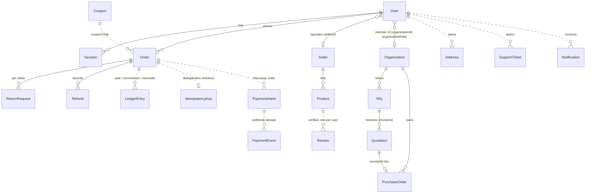

# Database model

Source of truth: [`apps/api/prisma/schema.prisma`](../../apps/api/prisma/schema.prisma). Money is stored as `NUMERIC(14,0)` paise and handled as integer paise in the domain. Order lines, fulfilments, history and price snapshots are stored on the order so later catalogue changes never rewrite what a customer bought.

## Key rules enforced in code

| Rule | Where |
| --- | --- |
| Prices, MOQ, tiers, coupons computed server-side only | `packages/shared/src/index.js` `priceLines`, `couponDiscount` |
| Checkout is idempotent per user + `Idempotency-Key`; stock decremented in the same transaction | `Marketplace.checkout` |
| All mutations run under one PostgreSQL advisory transaction lock (no oversell under concurrency) | `PrismaRepository.transaction` |
| One fulfilment per seller; transitions `PENDING → PACKED → SHIPPED → DELIVERED` (or `CANCELLED` before shipping) | `fulfillmentFlow`, `Marketplace.advanceFulfillment` |
| Ledger entries written on delivery; return approval writes equal and opposite entries | `Marketplace.advanceFulfillment`, `#refund` |
| Coupons are platform-funded: sellers' sales are recorded at full line value | `couponDiscount`, ledger `SALE` |
| PO approval: OWNER or APPROVER; an APPROVER cannot approve their own request; optional auto-approval threshold | `Marketplace.decidePurchaseOrder`, `acceptQuote` |

## Status values

- **Order**: `AWAITING_PAYMENT`, `CONFIRMED`, `SHIPPED`, `DELIVERED`, `CANCELLED`
- **Payment**: `UNPAID`, `PAID` (verified Razorpay), `DEMO_SIMULATED` (demo mode only, excluded from GMV)
- **Purchase order**: `PENDING_APPROVAL`, `APPROVED`, `REJECTED`, `CONFIRMED_BY_SELLER`
- **Refund**: `PENDING_PROVIDER` → `PROCESSED` (only with a Razorpay `rfnd_` reference), or `DEMO_SIMULATED`
