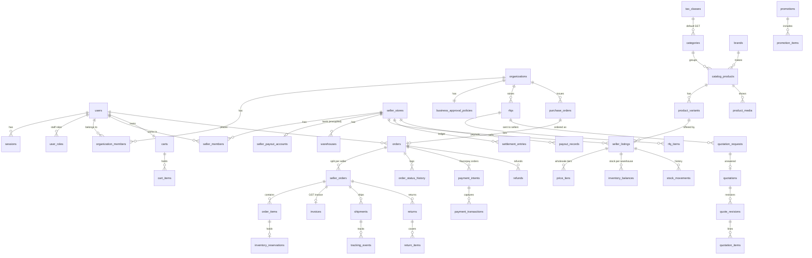

# Database

PostgreSQL 16+ (tested on 18), UTF-8, extension `pg_trgm`. Schema: `apps/api/prisma/schema.prisma` (79 tables).
Migrations: `apps/api/prisma/migrations`. Integrity CHECK constraints: `apps/api/prisma/integrity-checks.sql`.

## Core relationships

## Status flows

| Entity | Flow |
| --- | --- |
| Order | AWAITING_PAYMENT → CONFIRMED → PARTIALLY_SHIPPED / SHIPPED → DELIVERED; CANCELLED (unpaid, expired, or every parcel cancelled) |
| Seller order (parcel) | PENDING → PACKED → SHIPPED → DELIVERED; PENDING/PACKED → CANCELLED |
| Shipment | CREATED → PICKED_UP → IN_TRANSIT → OUT_FOR_DELIVERY → DELIVERED; FAILED_DELIVERY → OUT_FOR_DELIVERY / RETURNED |
| Return | REQUESTED → APPROVED / REJECTED → RECEIVED → REFUNDED (when the refund is actually paid) |
| Purchase order | PENDING_APPROVAL → APPROVED / REJECTED → CONFIRMED_BY_SELLER → ORDERED |
| Listing / product | PENDING → APPROVED / REJECTED / CHANGES_REQUESTED; APPROVED ↔ PAUSED |

## Safety rules

- Never run `prisma migrate reset` or `db push` against a shared or production database.
- Apply migrations with `npm run db:migrate` (`prisma migrate deploy`) as a release step, after a backup.
- Tests never touch `.env` databases: each test file gets its own database cloned from a migrated template in a
  disposable embedded PostgreSQL cluster, and the suite fails if `schema.prisma` drifts from the migrations.
